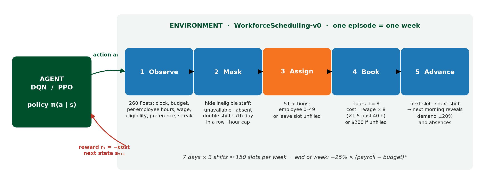
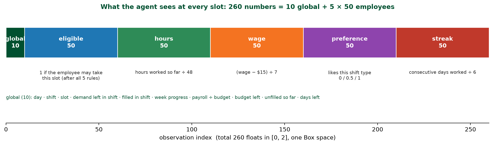
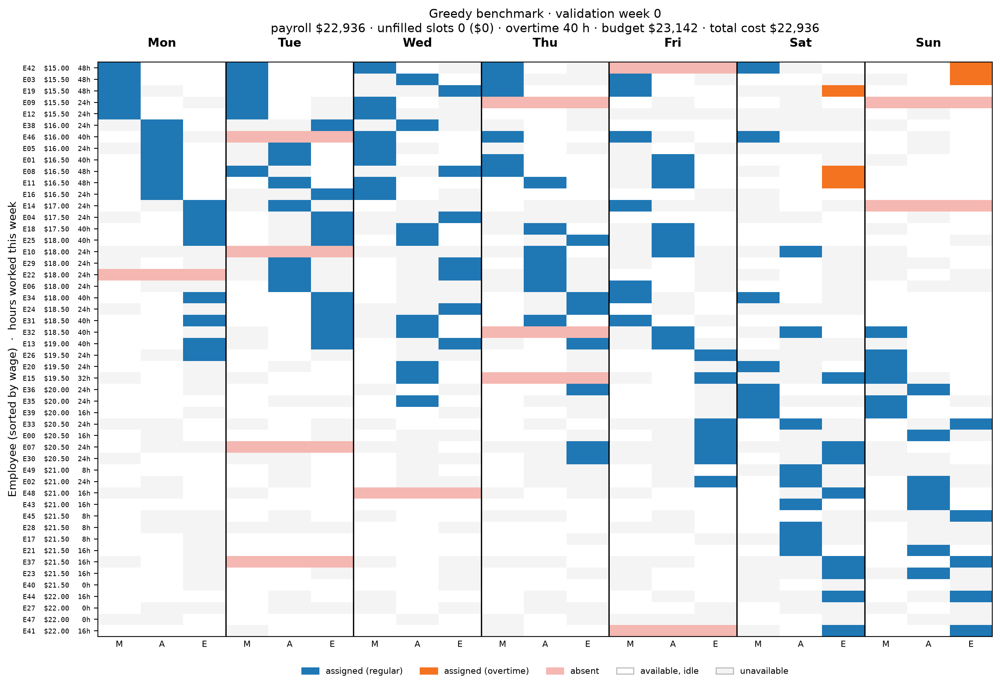

# Workforce Scheduling Agent

**BTE 422 — Tech Foundations of FinTech · University of Miami · Fall 2026 · Group 5**
Ryan Kaplan · Mike Jimenez · Hashim Shahzad Khan · Megan Knight · Shazaib Khan

A reinforcement-learning agent that assigns weekly shifts at minimum labor cost and
adapts as absences and demand change. This repo holds the custom **Gymnasium
environment**, the rule-based **benchmarks**, the **evaluation** harness, and the
**DQN / PPO** training scripts.



## Quick start

```bash
git clone <this repo> && cd workforce-scheduling-agent
python3 -m venv .venv && source .venv/bin/activate      # Python 3.10–3.12
pip install -r requirements.txt && pip install -e .

pytest -q                                   # 17 tests: Gymnasium check_env + our own rules
python scripts/run_benchmarks.py --n 50     # greedy / manager rule / fixed plan / random
python scripts/make_figures.py              # regenerates figures/*.png
```

```python
import gymnasium as gym, wsa
env = gym.make("WorkforceScheduling-v0")
obs, info = env.reset(seed=0)
mask = info["action_mask"]                  # which of the 51 actions are legal right now
obs, reward, terminated, truncated, info = env.step(env.action_space.sample(mask=mask))
```

Or open `notebooks/quickstart.ipynb` in Colab.

## The environment (`wsa/env.py`)

One episode = one week. The agent fills shift slots one at a time.

| MDP element | Implementation |
|---|---|
| **State** (260 floats) | 10 global: day, shift, slot, demand left in shift, filled in shift, week progress, payroll÷budget, budget left, unfilled so far, days left. Then 5 × 50 per employee: eligible-now, hours÷48, (wage−15)÷7, preference for this shift type, consecutive days÷6. |
| **Action** (`Discrete(51)`) | assign employee 0–49, or **50 = leave the slot unfilled**. `info["action_mask"]` / `env.action_masks()` flag eligible actions. An ineligible pick is scored as "unfilled". |
| **Transition** | hours and payroll update; after the last slot of a day the next morning reveals actual demand (forecast ±20%) and absences (~5%). |
| **Reward** | −cost: wage × 8 h (×1.5 beyond 40 h/week), **−$200** per unfilled slot, and at week end **−25 %** of payroll above budget (budget = 105 % of the Sunday forecast-plan cost). |
| **Episode** | 7 days × 3 shifts, ≈150 slots; ends after the last slot on Sunday. |



**Five frictions, all enforced by the mask** (`wsa/planning.py::eligible`):
overtime premium · unfilled-slot penalty (demand floored at the 2-person minimum) ·
no double shifts · at most 6 consecutive days · weekly hour cap (48 h full-time, 24 h part-time).

**Information rule.** The state only ever contains the forecast for future days.
Today's demand and absences enter the state the morning they are revealed, never earlier.
`tests/test_env.py::test_no_lookahead` changes days 4–6 of a week and checks that
observations and rewards through day 3 are identical.

**Synthetic company** (`wsa/company.py`): 50 employees, wages $15–$22 in $0.50 steps,
60 % full-time, availability ≈64 % of slots, one preferred shift type each. Generated from a
seed; `splits.HELD_OUT_COMPANY_SEED` is the unseen company for the final test.

**Weeks** (`wsa/week.py`): forecast per shift ≈ 7 × day factor (Fri 1.15, Sat 1.25, Sun 0.9)
× shift factor (evening busiest). Validation = seeds 0–299, test = seeds 1000–1999 (used once),
training draws from 100 000 up. No seed is in two splits.



## Benchmarks (`wsa/benchmarks.py`) — 300 validation weeks, company seed 0

| policy | mean weekly cost | gap vs greedy | worst 5 % | unfilled | OT hours |
|---|---:|---:|---:|---:|---:|
| greedy (cheapest eligible now) | $22,474 | 0.0 % | $24,265 | 0.02 | 27.9 |
| manager rule (fewest hours) | $23,056 | +2.6 % | $24,639 | 0.00 | 0.0 |
| fixed plan (Sunday plan, blind) | $23,130 | +2.9 % | $24,893 | 14.44 | 12.2 |
| random (uniform over eligible) | $23,690 | +5.4 % | $25,374 | 7.46 | 14.6 |

`python scripts/run_benchmarks.py` reproduces this. The agents' target is to beat greedy.
The fixed plan currently uses a greedy planner; **Ryan's MILP plan** should replace
`wsa.planning.greedy_forecast_plan` (same function also sets the budget).

## Training

```bash
python scripts/train_dqn.py --timesteps 1000000 --seed 0     # Megan  (SB3 DQN, slide-15 settings)
python scripts/train_ppo.py --timesteps 2000000 --seed 0     # Shaz   (sb3-contrib MaskablePPO)
```

Both scripts save to `models/`, then print the agent vs greedy vs manager-rule table on
validation weeks. Rewards are scaled by 0.01 during training (`scripts/common.py`); evaluation
reports raw dollars. Run 5 seeds each and report mean ± spread, never the best seed.
`wsa.evaluate.SB3Policy` wraps any saved model so Mike's test harness can score it.

## Repo layout

```
wsa/            environment package: config, company, week, planning, env, benchmarks, evaluate, render, splits
tests/          pytest suite (check_env, constraints, accounting, no-lookahead, reproducibility, benchmarks)
scripts/        run_benchmarks.py · make_figures.py · train_dqn.py · train_ppo.py · common.py
notebooks/      quickstart.ipynb (Colab)
figures/        slide graphics regenerated by make_figures.py
results/        benchmark CSV + chart from run_benchmarks.py
```

## Ownership (kickoff deck, slide 24)

| Who | Owns in this repo |
|---|---|
| Hashim (CTO) | `wsa/env.py`, company/week generators, tests, repo hygiene |
| Ryan (CEO) | greedy / manager rule / **MILP plan** benchmarks, integration |
| Megan (DQN) | `scripts/train_dqn.py`, DQN tuning, 5 seeds |
| Shaz (PPO) | week/demand generator review, `scripts/train_ppo.py`, PPO tuning, 5 seeds |
| Mike (COO) | cost metric, validation/test sets, stress tests, final test run, plots |

## Open design questions for the team

1. **Unfilled penalty vs. overtime.** Slide 19 says an unfilled slot must always cost more than any fill, but an overtime shift at the top wage is $22 × 8 × 1.5 = **$264 > $200**. Either raise `unfilled_penalty` (e.g. $300) or accept that leaving a slot open can be the rational choice late in the week. `EnvConfig(unfilled_penalty=...)` makes this a one-line change.
2. **Budget definition.** Budget = 1.05 × greedy forecast-plan cost until the MILP exists.
3. **Preferences** are in the state but not in the reward. Add a small preference bonus, or keep them as information only?
4. **Hindsight-optimal cost** (slide 17's primary metric) needs the MILP with full information. Until then the table reports the gap vs the best benchmark.
